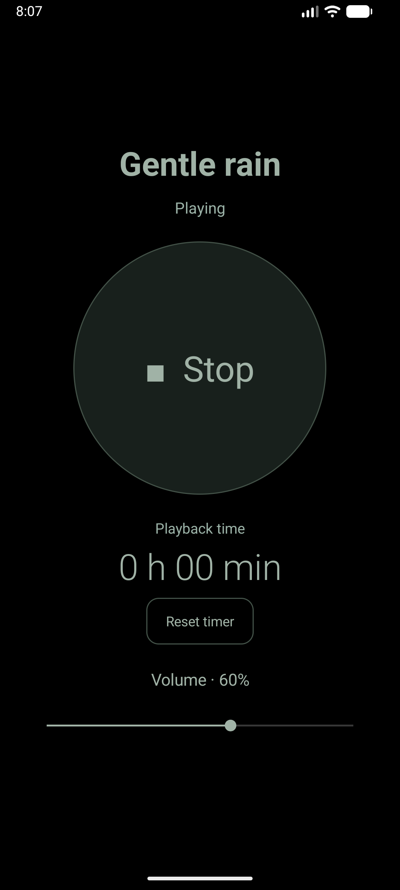

# Quiet Noise — Gentle rain

A simple Android app that plays a smooth, rain-like noise to help babies settle down and fall asleep. The sound is included in the app, so no internet connection is needed. Turn on flight mode for an uninterrupted bedtime, then start the rain and lock the screen.

  

The dark interface keeps things comfortable in a dim room, with just the controls you need:

- **Play / Stop:** rain loops continuously until stopped. Pressing Play gradually fades the sound in over five seconds to avoid a sudden loud blast. Pressing Stop gently fades it out over five seconds instead of ending abruptly.
- **Volume:** adjust the rain to a comfortable level. The default is 60%, and the app remembers your changes.
- **Playback time:** shows elapsed hours and minutes. Stop keeps the final time visible; pressing Play starts a new timer.
- **Reset timer:** sets the timer back to zero without interrupting the rain. Press it when your child has settled and you leave the room to track more closely how long they have been asleep.

Rain continues with the screen locked or the app in the background. A dark media card keeps Play/Stop and the timer accessible from notifications. To close the app completely, swipe it away from Recent apps.

## Sound

The app uses [Light Rain by soundrecorder7](https://freesound.org/people/soundrecorder7/sounds/167034/), shared under [CC0](https://creativecommons.org/publicdomain/zero/1.0/). The recording is bundled with the app and loops continuously without needing an internet connection.
